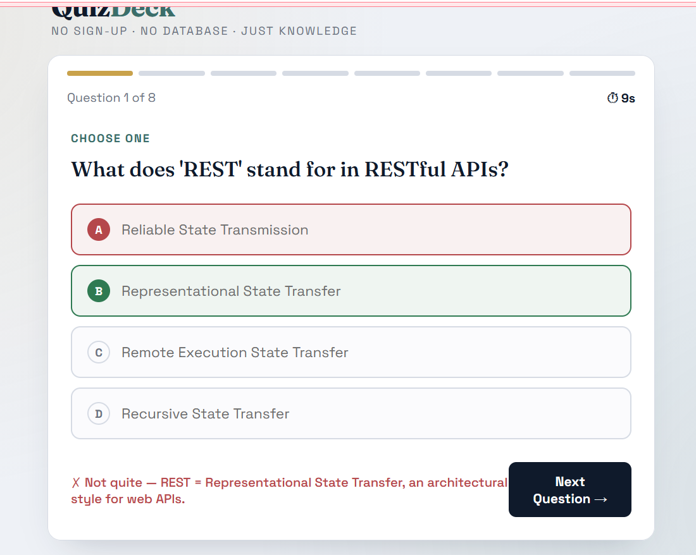
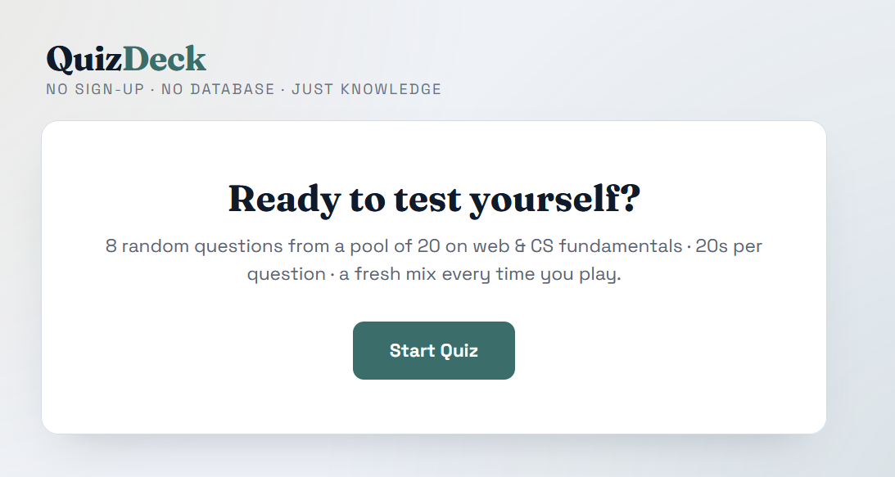

# QuizDeck

QuizDeck is a simple quiz web application built using HTML, CSS, and JavaScript.

## Features

- Random questions every time
- Timer for each question
- Instant answer feedback
- Progress bar
- Final score with accuracy
- Responsive design
- No database required

## Technologies Used

- HTML5         # for Structure
- CSS3          # for Designing
- JavaScript    # for Responsive design

Screenshots

## How to Run

1. Download or clone the 
2. Open `index.html` in any web browser.
3. Click **Start Quiz** to begin.

## Author

Deepshikha Singh